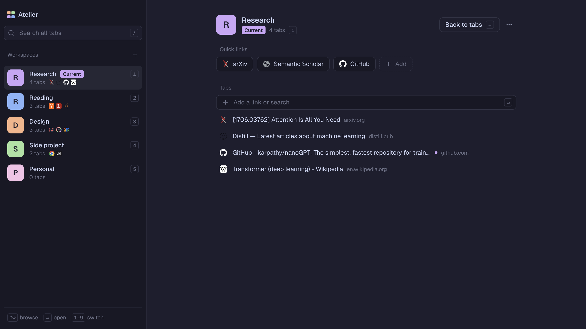
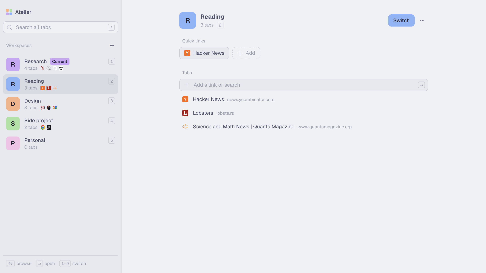
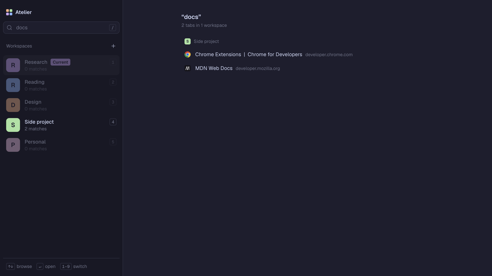

# Atelier

Named workspaces inside a single browser window, for Chromium-based browsers. Each
workspace keeps its own tabs, and switching moves tabs instead of closing them, so
pages do not reload.

I built this after [Workona](https://workona.com) left a pile of stuck pinned tabs in
my browser. It has no account, no server and no tracking; everything stays in the
browser's local extension storage. I have tested it on
[Helium](https://helium.computer) 0.22.4.1 (Chromium 158) on macOS. Other Chromium
browsers should probably work as well.



---

## 1. Install

1. Clone the repo somewhere you will keep it:

   ```sh
   git clone https://github.com/sumitdotml/atelier.git
   ```

   Or download it as a ZIP from GitHub (Code → Download ZIP) and unzip it.
2. Open your browser's extensions page (`chrome://extensions`, or `helium://extensions`
   in Helium) and turn on Developer mode.
3. Click "Load unpacked" and choose that folder (`atelier` if you cloned it,
   `atelier-main` if you unzipped it).
4. The tabs in your current window become the first workspace, "Main".

To update, run `git pull` in that folder and click the reload icon on the extension's
card. Reloading keeps your workspaces. Removing the extension deletes them, and so does
moving or renaming the folder, since the browser derives an unpacked extension's ID
from the folder's path.

---

## 2. Use

A small pinned tab at the start of the tab strip shows the current workspace's colour
and first letter. Opening it (or clicking the toolbar icon, or pressing ⌘⇧Space,
Ctrl+Shift+Space outside macOS) shows the workspaces page. It works like an email
inbox, with workspaces on the left and the one you pick on the right.

| Action                              | How                                                         |
| ----------------------------------- | ----------------------------------------------------------- |
| Switch to a workspace               | click it, 1 to 9 on the page, or ⌃1 to ⌃3 anywhere          |
| Switch and go straight to its tabs  | double-click it, or Enter                                   |
| Look inside without switching       | ↑ / ↓                                                       |
| Move a tab to another workspace     | drag it onto a workspace, or its arrow button               |
| Add a link as a tab                 | the field above the tabs (plain text becomes a Kagi search) |
| Save, rename or remove a quick link | the bookmark button on a tab, or hover the link             |
| New workspace                       | the + next to "Workspaces", or N                            |
| Rename, recolour, delete            | the ⋯ menu                                                  |
| Reorder (sets the numbers)          | drag workspaces in the list                                 |
| Resize the list                     | drag its edge; double-click to reset                        |
| Search tabs in every workspace      | /                                                           |
| Send the current page elsewhere     | right-click it, "Move tab to workspace"                     |





Shortcuts for workspaces 4 to 9 are not set by default, because an extension can
suggest at most four. You can set them on `chrome://extensions/shortcuts`.

---

## 3. How it works

- The current workspace's tabs live in your window. Every other workspace's tabs wait
  in one extra window, "Parked workspaces", which keeps itself minimized.
- Pinned tabs never move, so every workspace shares them.
- Names, colours, quick links and tab lists survive restarts. After a restart only the
  last workspace reopens its tabs; the others do so the first time you switch to them.
  Pages reload then, without their scroll position or back/forward history.
- Closing the parking window loses nothing; those workspaces reopen from their saved lists.
- Tab groups inside a workspace are not kept when you switch away.

---

## 4. Uninstalling

Just unpin and close the workspaces tab before removing the extension.

---

## 5. License and credits

[MIT](./LICENSE). Fonts are Geist and Geist Mono ([SIL Open Font License](fonts/OFL.txt)), icons are from [Lucide](https://lucide.dev) ([ISC License](LUCIDE-LICENSE.txt)) and colours are from [Catppuccin](https://catppuccin.com).
